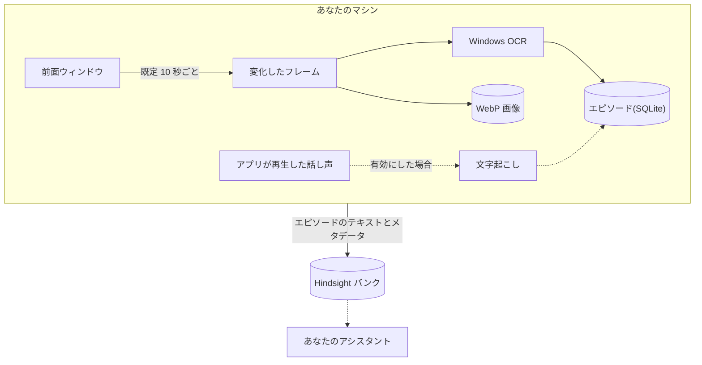

# ContextWitness

[](https://github.com/Skyzi000/contextwitness/actions/workflows/ci.yml)
[](LICENSE)


[English](README.md) | 日本語

**PC 上での人の活動を、AI が参照できる記憶にする Windows 常駐デーモンです。**

目指しているのは、PC 上での活動すべてを記憶にすることです。いま記録するのは、画面と、有効にした場合はアプリが再生した話し声の 2 つです。前面ウィンドウを一定間隔でキャプチャして Windows OCR で文字を読み取り、音声の記録を有効にしていれば、その話し声も文字に起こします(音そのものは残しません)。こうして得たテキストを時刻つきのエピソードにまとめて、[Hindsight](https://github.com/vectorize-io/hindsight) のメモリバンクへ配送します。そのバンクにつないだアシスタントは「火曜の午後は何をしてた?」のような質問に答えられるようになります。

> [!IMPORTANT]
> ContextWitness は画面を記録します。音声の記録を有効にすると(既定では無効です)、アプリが再生した話し声も文字にして記録します。実行する前に[プライバシー](#プライバシー)を読んでください。

## 仕組み



話し声からの経路は[音声の記録](#音声の記録)で、自分で有効にしたときだけ動きます。文字起こしは自分のマシン上で行われます。文字起こし API を使う設定にした場合は、音声がその API へ送られます。

## 動作要件

- **Windows 11 24H2**(ビルド 26100)以降。
- エピソードを配送するには、稼働している [Hindsight](https://github.com/vectorize-io/hindsight) サーバー(**v0.8.6** 以降)。

## インストール

次のどちらかで入れます:

- **Portable ZIP** — [Releases](https://github.com/Skyzi000/contextwitness/releases) から `contextwitness-vX.Y.Z-windows-x86_64.zip` をダウンロードして、任意の場所へ展開します。
- **ソースから** — [ソースからのビルド](#ソースからのビルド)の手順でビルドします(Rust の MSVC ツールチェーンが必要)。`contextwitness` コマンドが入ります。

バイナリは署名なしのオープンソースビルドのため、初回実行時に Windows SmartScreen が警告することがあります。

## クイックスタート

ZIP 版は PATH に登録されません。以下の `contextwitness` を `.\contextwitness.exe` に読み替え、`contextwitness.exe` のあるフォルダで実行してください。

```text
contextwitness setup
contextwitness run
```

`setup` は Hindsight API URL・API トークン(任意)・データディレクトリを尋ねて書き込みます。`run` はトレイアイコンを出してキャプチャを開始し、トレイメニューの Quit で終了するまで動き続けます。

エピソードは Hindsight の `contextwitness` バンクへ配送されます。バンクが無ければ自動で作成します([Hindsight バンク](#hindsight-バンク)を参照)。動作状況は、別のターミナルで `contextwitness status` を実行すると確認できます。

アプリが再生した話し声も記録したい場合は、[音声の記録を有効にする](#音声の記録を有効にする)を参照してください。

### その他のコマンド

| コマンド | 内容 |
| --- | --- |
| `status` | 現在の動作状況を 1 画面で表示する。 |
| `pause [30m\|2h\|...]` | 画面と音声の記録を一時停止する。時間を指定しなければ `resume` するまで。 |
| `resume` | 記録を再開する。 |
| `defaults` | 全設定の既定値と意味、Hindsight バンクに設定する mission を表示する。 |
| `autostart enable\|disable` | ログオン時の自動起動。 |
| `capture-once` | 動作確認用に画面を 1 回だけキャプチャする。一時停止中でも実行される。 |

## できること

- **キャプチャ。** 前面ウィンドウを一定間隔(既定 10 秒)で Windows Graphics Capture を使ってキャプチャし、一定量を超えるピクセルが変化したときだけフレームを保存します。他のウィンドウとモニターはキャプチャしません。前面ウィンドウの上に別のウィンドウが重なっていても、写るのは前面ウィンドウの内容で、重なったウィンドウは写りません。
- **OCR。** 画面上のテキストを Windows OCR エンジンで抽出します。設定した言語のうちインストール済みエンジンが存在する最初のものを使います(既定は日本語→英語の順)。
- **エピソード。** キャプチャを一定時間(既定 5 分)ごとに 1 つのエピソードへまとめ、時刻つきの活動ログにします。同じエピソードの中で同じウィンドウを再びキャプチャしたときは、前回のキャプチャとの差分のほうが短ければ、差分で記録します。それ以外は全文を記録します。
- **フレームの無い時間。** フレームを保存しなかった時間帯も、その状態をエピソードに残します。保存するほどの変化が無かった、新しいフレームが届かなかった、キャプチャできる前面ウィンドウが無かった、一時停止していた、ブラックリストでスキップした、キャプチャや保存に失敗した(エラー文つき)、といった状態です。記録が途切れていた時間も、途切れとして残します。
- **音声(任意)。** アプリが再生した話し声を文字に起こし、画面エピソードとは別の音声エピソードとして配送します。[音声の記録](#音声の記録)を参照してください。
- **ローカル優先。** すべてをまずローカルへ保存します。エピソードは SQLite に、フレームは WebP 画像として保存し、画像は既定で 14 日・50 GiB まで保持します。
- **配送。** エピソードを Hindsight へ配送します。未配送のエピソードはローカルに保存されているので、サーバーが落ちている間は待機し、復帰後に配送されます。
- **トレイ。** トレイアイコン付きで常駐します。一時停止と再開は、トレイからもコマンドラインからもできます。ログオン時の自動起動は任意です。

### エピソードの例

架空の内容で作った画面エピソードです:

```text
[2026-07-25T01:00:00+09:00 - 2026-07-25T01:05:00+09:00] Screen episode

2026-07-25T01:00:01+09:00 [editor.exe] checklist.txt
  Release checklist
  1. Run the test suite
  2. Update the changelog
  3. Tag the release
  4. Publish the build
  Status: Open
  Owner: A
  Notes: none

2026-07-25T01:00:11+09:00 - 2026-07-25T01:01:31+09:00 [editor.exe] checklist.txt
  [no change above the capture threshold]

2026-07-25T01:01:41+09:00 [viewer.exe] diagram.png
  Figure 1: release flow

2026-07-25T01:02:11+09:00 [editor.exe] checklist.txt (changes since 2026-07-25T01:00:01+09:00)
  @@ -5,3 +5,3 @@
    4. Publish the build
  - Status: Open
  + Status: Done
    Owner: A

2026-07-25T01:02:21+09:00 - 2026-07-25T01:05:00+09:00
  [capture paused]
```

## 音声の記録

音声の記録は任意の機能で、既定では無効です。有効にすると、この PC でアプリが再生した話し声(通話、動画、ゲームなど)を文字にして記録します。

- **記録するもの。** アプリが再生した音です。音を再生しているアプリごとに別々に録り、話し声と判定した部分だけを、ひと続きの話し声(以下「発話」)ごとに文字へ起こします。アプリが音を出し始めてから録り始めるまでに少し時間がかかるため(ふつうは 1 秒ほど)、出だしが欠けることがあります。
- **音そのものは保存しません。** 音は文字に起こすまでメモリ上にあるだけで、ディスクには書き込みません。保存して配送するのはテキストです。
- **文字起こしの方法。** 既定では、自分でダウンロードしたモデルをこの PC 上で動かします。このとき音は PC の外へ出ません。代わりに文字起こし API を使うこともでき、その場合は発話ごとの音声がその API へ送られます。
- **起こしたテキストには誤りが含まれます。** 機械による文字起こしなので聞き間違いがあり、特に固有名詞は誤りやすくなります。誰が話したかは区別しません。
- **音声エピソード。** 起こしたテキストは、画面と同じ区切り(既定 5 分)でまとめ、画面エピソードとは別のドキュメントとして配送します。音声エピソードが作られるのは、話し声を記録した区切りだけです。
- **負荷。** 音声の記録は専用の別プロセスで動きます。PC 上のモデルを使う場合、このプロセスは動いている間ずっとモデルをメモリに載せ、話し声が流れている間は CPU を使います。

有効にする手順は[音声の記録を有効にする](#音声の記録を有効にする)に、プライバシーへの影響は[プライバシー](#プライバシー)にあります。

### 音声エピソードの例

架空の内容で作った音声エピソードです:

```text
[2026-07-25T01:00:00+09:00 - 2026-07-25T01:05:00+09:00] Audio episode

2026-07-25T01:00:12+09:00 - 2026-07-25T01:01:40+09:00 [talk.exe]
  01:00:12 来週のリリース、チェックリストはもう終わっていますか。
  01:00:19 はい、残りは告知文だけです。
  01:01:36 では金曜に出しましょう。

2026-07-25T01:00:21+09:00 - 2026-07-25T01:00:39+09:00 [player.exe]
  01:00:21 図1はリリースの流れを示しています。
  01:00:34 [transcription failed: HTTP 503 Service Unavailable]

2026-07-25T01:00:45+09:00 - 2026-07-25T01:01:20+09:00
  [audio capture skipped by the process blacklist: vault.exe]

2026-07-25T01:02:21+09:00 - 2026-07-25T01:05:00+09:00
  [audio capture pause requested for this period]
```

- **エントリは、発話をアプリごとにまとめたものです。** 見出しには、その発話の時間範囲と、音声を録ったアプリの実行ファイル名が入ります。そのアプリ自身が音を再生している間は、そのアプリが起動したプログラムの話し声も同じ名前で記録されます。上の 2 つのように、別のアプリのエントリどうしは時間が重なることがあります。
- **1 行が 1 つの発話です。** 行頭は発話が始まったローカル時刻です。
- **角括弧の行**は、文字に起こせなかった発話です。理由が付きます(この例では文字起こし API が返したステータスです)。
- **`[audio capture skipped by the process blacklist: …]`** の付いた時間範囲は、ブラックリストのために音声を記録しなかった時間です。名前は、原因になったブラックリストのプログラムです。
- **`[audio capture pause requested for this period]`** の付いた時間範囲は、一時停止が指定されていた時間です。指定した時点から、再開するか期限が切れるまでを表します。記録が止まるのは指定の 1 秒ほど後なので、範囲の始まりの発話が残ることがあります。

## プライバシー

ContextWitness は画面を記録し、音声の記録を有効にしていれば、アプリが再生した話し声も記録します。実行する前に、次の点を確認してください:

- **既定では何も除外しません。** 前面ウィンドウに表示された内容は、機密情報も含めてすべて記録の対象です。別のウィンドウが重なって見えなくなっている部分も記録され、OCR が認識したテキストはすべて保存されます。各エントリには、取得できる限り、そのウィンドウのタイトルとプロセス名も記録されます。
- **ContextWitness が送る先は、自分で設定したサーバーだけです。** Hindsight サーバーへ送るのは、エピソードのテキスト(ウィンドウタイトル、プロセス名、キャプチャ状況の行とそのエラー文も入ります)と、そのメタデータ(エピソードの時刻とエントリ数)です。キャプチャ画像は送りません。Hindsight に届いたテキストがその先どこへ送られるかは、Hindsight の設定で決まります。Hindsight が外部の LLM や埋め込みサービスを使う設定なら、テキストはそこへも送られます。音声の記録で加わる分は[音声の記録を有効にした場合](#音声の記録を有効にした場合)にあります。
- **`privacy.process_blacklist`** は、列挙したプロセス(実行ファイル名で照合、大文字小文字は区別しない)が前面にある間、キャプチャをスキップします。スキップしたことと、その原因になったプロセス名はエピソードに記録されます。ブラックリストを設定していて前面のプロセスを特定できなかったときも、その回のキャプチャをスキップします。音声では、より広い範囲に効きます。[音声の記録を有効にした場合](#音声の記録を有効にした場合)を参照してください。
- **一時停止。** トレイメニューか `contextwitness pause 30m` で、画面と音声の記録を止められます(時間を指定しなければ `resume` するまで)。
- **画像の保持期間。** 保存した画像は、保持日数と総容量の上限に従って削除されます。対象は画像だけで、ローカルデータベースのエピソードテキスト(起こしたテキストも含む)とログは自動では削除されません。
- **ログは機密情報です。** ログはデータディレクトリ(既定は `%LOCALAPPDATA%\ContextWitness`)の `logs` フォルダに保存され、ウィンドウタイトル・プロセス名・OCR テキスト・起こしたテキストなど、記録した内容が入ることがあります。たとえば、サーバーがエピソードを拒否すると、返ってきたエラー文にそのエピソードの内容が引用されていることがあり、それがログに記録されます。`contextwitness status` も直近の配送エラーを表示するので、その出力も同じように扱ってください。

### 音声の記録を有効にした場合

音声の記録を有効にすると、次のことが加わります:

- **アプリが再生した話し声は、すべて記録の対象です。** 通話の相手の声も、動画やゲームの音声も、機密情報を含めて文字に起こし、時刻とアプリの実行ファイル名を付けて保存します。音そのものは保存しません。文字に起こすまでメモリに置くだけです。
- **送る先。** PC 上のモデルで文字に起こす場合、音声はどこへも送りません。文字起こし API を使う場合は、発話ごとの音声を、設定したその API へ送ります。起こしたテキストは、画面のテキストと同じく、実行ファイル名と時刻を付けて Hindsight へ送ります。
- **記録したくないものはブラックリストに入れます。** `privacy.process_blacklist` に入れたプログラムの音は、前面にあるかどうかに関係なく記録しません。次の音も記録しません:
  - そのプログラムが起動したプログラムの音(さらにその先で起動されたものも含みます)
  - そのプログラムを配下で動かしているアプリの音(動いている間だけ)

  ブラックリストを設定している間は、名前を読み取れないプログラムの音も記録しません。記録しなかった時間は、原因になったブラックリストのプログラム名と一緒に、音声エピソードに残ります。
- **ブラックリストで防げない場合。**
  - 記録中のアプリの配下で、ブラックリストのプログラムが起動した直後。気づくまでの 1 秒ほどの音は、文字に起こされることがあります。
  - ブラックリストのプログラムが終了したあと。それが起動していたプログラムは、ほかのプログラムと同じように記録します。
- **一時停止しても、すぐには止まりません。** 止まるまで 1 秒ほどかかります。その時点で途中だった発話は捨てます。すでに終わっていた発話は、一時停止のあとも文字に起こして保存します。文字起こし API を使っている場合は、その音声が API へ送られます。
- **ログに残るもの。** 記録したアプリの名前、発話ごとの長さと文字数、文字起こしに失敗した理由です。文字起こし API がリクエストを拒否した場合は、API の応答の冒頭も残ります。起こしたテキストは残りません。

## 設定

設定ファイルは `%APPDATA%\ContextWitness\config.toml` です。このファイルが無い状態で `setup` か `run` を実行すると、`storage.data_dir` と `hindsight.bank_id` だけを書いたものが作られます。書かれていない設定は、実行中のバージョンの既定値に従います。そのため、更新で既定値が変われば、それがそのまま適用されます。全設定の既定値は `contextwitness defaults` で表示できます。

設定は起動時に読み込まれるので、変更は起動し直すまで反映されません(ブラックリストへの追加も同じです)。変更したら、トレイメニューの Quit で終了し、`contextwitness run` で起動し直してください。

| キー | 既定値 | 意味 |
| --- | --- | --- |
| `capture.interval_secs` | `10` | キャプチャ試行の間隔秒数(1–30)。 |
| `capture.change_pixel_threshold` | `8` | ピクセルごとの輝度差がこの値以下なら「変化なし」と数える(0–254)。 |
| `capture.change_area_logical_pixels` | `600` | 変化した論理ピクセル数(表示スケーリング 100% 換算)がこれを超えたらフレームを保存して OCR する。 |
| `capture.webp_quality` | `75` | WebP エンコード品質(0–100)。 |
| `ocr.languages` | `["ja", "en"]` | OCR に使う言語の候補。先頭から順に試し、OCR エンジンがインストールされている最初の言語を使う。どの言語にも無ければ、Windows のユーザープロファイルの言語を使う。 |
| `audio.enabled` | `false` | アプリが再生した話し声を文字にして記録する。[音声の記録を有効にする](#音声の記録を有効にする)を参照。 |
| `audio.backend` | `"local"` | 文字起こしの方法。`"local"`(この PC 上のモデル)か `"api"`(文字起こし API)。 |
| `audio.model_dir` | `""` | `"local"` 用。モデルのフォルダ。空ならデータディレクトリの `models` にあるモデル、それ以外は絶対パス。 |
| `audio.api_model` | `""` | `"api"` 用。API に指定するモデル名。 |
| `audio.language` | `""` | 話し声の言語(例: `"ja"`)。空なら文字起こしの側が判定する。 |
| `storage.data_dir` | `""` | データディレクトリ。空なら `%LOCALAPPDATA%\ContextWitness`、それ以外は絶対パス。 |
| `storage.image_retention_days` | `14` | キャプチャ画像を保持する日数。 |
| `storage.image_retention_max_gib` | `50` | キャプチャ画像全体の容量上限(GiB)。 |
| `privacy.process_blacklist` | `[]` | 画面と音声を記録しないプログラムの実行ファイル名(例: `["vault.exe"]`)。[プライバシー](#プライバシー)を参照。 |
| `hindsight.bank_id` | `"contextwitness"` | エピソードの配送先となる Hindsight バンク。[Hindsight バンク](#hindsight-バンク)を参照。 |
| `hindsight.context_label` | [下記参照](#context-ラベル) | すべての画面エピソードに添えて送られる context ラベル。 |
| `hindsight.audio_context_label` | [下記参照](#音声用の-context-ラベル) | すべての音声エピソードに添えて送られる context ラベル。 |
| `episode.window_minutes` | `5` | 1 つのエピソードにまとめる時間の長さ(分、1–1440)。 |

### 音声の記録を有効にする

音声の記録は、`audio.enabled` を `true` にするまで行われません。あわせて、話し声を文字に起こす手段が必要です。手段は `audio.backend` で選びます。この PC 上で動かすモデル(`"local"`、既定)か、文字起こし API(`"api"`)です。有効にする前に、[プライバシー](#プライバシー)を、[音声の記録を有効にした場合](#音声の記録を有効にした場合)まで読んでください。

**PC 上のモデルを使う場合。** ContextWitness にモデルは付属しません。読み込めるのは、[sherpa-onnx](https://github.com/k2-fsa/sherpa-onnx) プロジェクトが公開している形式の SenseVoice モデルです。動作を確認しているのは `sherpa-onnx-sense-voice-zh-en-ja-ko-yue-int8-2024-07-17` で、中国語・広東語・英語・日本語・韓国語に対応しています。

このモデルは第三者が公開しているもので、ライセンスも ContextWitness とは別です。モデルに同梱の `LICENSE` ファイルは、[FunASR リポジトリのライセンスの節](https://github.com/modelscope/FunASR?tab=readme-ov-file#license)を参照先にしています。その節には、モデルの重みのライセンスはコードとは別であることが書かれ、[FunASR Model Open Source License Agreement](https://github.com/modelscope/FunASR/blob/main/MODEL_LICENSE) へのリンクがあります。モデルを使う前に読んでください。

1. sherpa-onnx の [`asr-models` リリース](https://github.com/k2-fsa/sherpa-onnx/releases/tag/asr-models)から [`sherpa-onnx-sense-voice-zh-en-ja-ko-yue-int8-2024-07-17.tar.bz2`](https://github.com/k2-fsa/sherpa-onnx/releases/download/asr-models/sherpa-onnx-sense-voice-zh-en-ja-ko-yue-int8-2024-07-17.tar.bz2)(約 160 MB)をダウンロードします。
2. 展開します。この形式は Windows 標準の `tar` で展開できます。ファイルのあるフォルダでターミナルを開き、`tar -xf sherpa-onnx-sense-voice-zh-en-ja-ko-yue-int8-2024-07-17.tar.bz2` を実行してください。同じ名前のフォルダ(約 240 MB)ができます。
3. そのフォルダを、名前を変えずに、データディレクトリの `models` へ移します。`storage.data_dir` を変えていなければ `%LOCALAPPDATA%\ContextWitness\models` です。`models` は ContextWitness が起動時に作ります。
4. `config.toml` に次を追加します。

   ```toml
   [audio]
   enabled = true
   ```

5. ContextWitness を起動し直します。トレイメニューの Quit で終了し、`contextwitness run` を実行してください。
6. 動いていることを確認します。`contextwitness status` の `audio worker` の行に、現在時刻より少し前の時刻が表示され、進み続けます。`never` のままの場合や、時刻が進まない場合は、[音声の記録の詳細](#音声の記録の詳細)を参照してください。

モデルを別のフォルダに置く場合や、別の SenseVoice モデルを使う場合は、`model.int8.onnx` と `tokens.txt` があるフォルダの絶対パスを `audio.model_dir` に書きます。一重引用符で囲むと、バックスラッシュをそのまま書けます(例: `model_dir = 'C:\Models\sense-voice'`)。

**文字起こし API を使う場合。** OpenAI 互換の API が必要です。ContextWitness は発話ごとに `<api_url>/audio/transcriptions` へ POST し、JSON の応答から `text` を読み取ります。

1. API の URL と、必要ならキーを、`config.toml` と同じフォルダの `%APPDATA%\ContextWitness\credentials.toml` に書きます。`config.toml` には書きません。`setup` も尋ねません。

   ```toml
   [transcription]
   api_url = "https://transcription.example/v1"
   api_key = "your-key"
   ```

2. `config.toml` に次を追加します。`audio.api_model` は API に指定するモデル名です。指定が不要な API では省略できます。

   ```toml
   [audio]
   enabled = true
   backend = "api"
   api_model = "your-model-name"
   ```

3. ContextWitness を起動し直し、上の手順 6 と同じように `audio worker` の行を確認します。

ファイルの代わりに環境変数も使えます。`CONTEXTWITNESS_TRANSCRIPTION_URL` と、キーが必要なら `CONTEXTWITNESS_TRANSCRIPTION_KEY` です。URL の環境変数が設定されているときは環境変数だけを使い、ファイルは読みません。ファイルと環境変数を組み合わせることはできません。キーの環境変数だけを設定するとエラーになり、URL が無くキーだけを書いたファイルもエラーになります。API へ送るものは[音声の記録の詳細](#音声の記録の詳細)にあります。

### Hindsight バンク

エピソードは `hindsight.bank_id` のバンク(既定は `contextwitness`)へ配送されます。

- **バンクが無ければ自動で作ります。** ContextWitness が送るテキスト(画面の OCR テキストと、話し声を起こしたテキスト)に合わせた初期設定も一緒に入れます。これには Hindsight の bank config API(`HINDSIGHT_API_ENABLE_BANK_CONFIG_API`)が有効になっている必要があります。
- **すでにあるバンクの設定は、1 つを除いて変更しません。** Hindsight 側で変えた設定はそのまま残ります。例外は、ContextWitness 自身が書いた `observations_mission` です。新しい版でエピソードの形が変わると、その版の文面に置き換えます。自分で書いた mission は変更されません。
- **バンク ID は ContextWitness 専用にしてください。** 別のプログラムが同じ ID のバンクを同時に作ると、そのプログラムが作ったバンクに ContextWitness の初期設定が書き込まれることがあります。

初期設定の中身、mission が置き換わる条件、bank config API が無効な場合の手順は、[バンク初期化の詳細](#バンク初期化の詳細)にあります。

### context ラベル

`hindsight.context_label` は、画面エピソードごとに添えて Hindsight へ送る説明文です。記憶と一緒に保存され、記憶を読むアシスタントに、そのテキストが何で、どう読めばよいかを伝えます。通常は変更する必要はありません。`config.toml` に書かなければ、実行中のバージョンの既定値が使われます。

既定値:

> Time-stamped OCR text of the foreground window, with its application and window title where known. An entry headed (changes since \<time\>) is a unified diff of OCR lines against that window's entry at \<time\>: to read that entry, call list_memories with q set to \<time\> (a substring search, not relevance-ranked recall) and use the entry headed by that time in the same document, repeating while it is itself a change entry. May contain OCR errors; shows what was displayed, not what the user read, wrote, or did.

### 音声用の context ラベル

`hindsight.audio_context_label` は、同じ役割を持つ音声エピソード用の説明文です。音声エピソードごとに添えて送られ、そのテキストが機械による文字起こしであることと、エントリの読み方を、記憶を読むアシスタントに伝えます。通常は変更する必要はありません。`config.toml` に書かなければ、実行中のバージョンの既定値が使われます。

既定値:

> Machine transcripts of speech that applications played on this PC. Each entry is headed by a time range and the application the audio was captured from, which can include sound from programs that application started; each line begins with the local time its utterance started. Expect misheard words, especially names. Shows what was played, not what the user listened to or did.

### 資格情報

Hindsight の資格情報(API URL とトークン)は `config.toml` には書きません。次のどちらか一方から読みます:

- **ファイル。** `setup` が `%USERPROFILE%\.hindsight\contextwitness.json` に保存します。
- **環境変数。** `CONTEXTWITNESS_HINDSIGHT_URL` と、トークンが必要なら `CONTEXTWITNESS_HINDSIGHT_TOKEN`。URL の環境変数が設定されているときは環境変数だけを使い、ファイルは読みません。

ファイルと環境変数を組み合わせることはできません。トークンの環境変数だけを設定するとエラーになります。

文字起こし API の URL とキー(`audio.backend = "api"` のときだけ必要)は、これとは別に置きます。[音声の記録を有効にする](#音声の記録を有効にする)を参照してください。

## 更新とアンインストール

**更新。** トレイメニューの Quit で終了してから、新しい版の `contextwitness.exe` に切り替えます。自動起動は、登録したときの `contextwitness.exe` の場所を指しています。ZIP は版ごとに別の名前のフォルダへ展開されるので、場所が変わったときは、新しい `contextwitness.exe` で `autostart enable` をもう一度実行してください。音声の記録は既定で無効なので、音声の記録に対応していない版から更新しても、有効にはなりません。ソースから入れた場合は[ソースからのビルド](#ソースからのビルド)を参照してください。

**アンインストール。** 次の順に行います:

1. 自動起動を登録している場合は、`contextwitness autostart disable` で解除します。
2. トレイメニューの Quit で終了し、`contextwitness.exe` を削除します(ソースから入れた場合は `cargo uninstall cw-daemon`)。

`contextwitness.exe` を削除しても、次のものは残ります。不要なら削除してください:

- **ローカルの記録。** エピソード・画像・ログ。データディレクトリ(既定は `%LOCALAPPDATA%\ContextWitness`)にあります。音声の記録を有効にしていた場合は、話し声の検出に使う小さなファイル `silero_vad.onnx` も、ContextWitness がここに書き出しています。
- **設定。** `%APPDATA%\ContextWitness\config.toml`。
- **資格情報。** `%USERPROFILE%\.hindsight\contextwitness.json`。`credentials.toml` を作った場合は、`%APPDATA%\ContextWitness\credentials.toml` も残ります。
- **文字起こしのモデル。** データディレクトリの `models`、または `audio.model_dir` に書いたフォルダ。
- **Hindsight へ配送済みの記憶。** Hindsight サーバーのバンクに残ります。消すには、Hindsight 側でバンクを削除します。
- **ソースから入れた場合のクローン。** クローンしたフォルダと、その中に取得・ビルドされたもの。

## ソースからのビルド

ビルドには Git と Rust の MSVC ツールチェーンが必要です。このリポジトリは `cargo install --git` だけではビルドできません。ビルドに使うネイティブライブラリと、話し声の検出に使う小さなモデルを、先にスクリプトでクローンの中へ取得しておく必要があるためです。PowerShell かコマンドプロンプトで、次を実行します:

```text
git clone https://github.com/Skyzi000/contextwitness
cd contextwitness
powershell -ExecutionPolicy Bypass -File scripts/fetch-sherpa-onnx.ps1
cargo install --path crates/cw-daemon
```

スクリプトは [sherpa-onnx](https://github.com/k2-fsa/sherpa-onnx) の GitHub リリースから 2 つのファイルをダウンロードします。sherpa-onnx の静的ライブラリ(約 120 MB、展開後は約 1 GB)と、話し声の検出に使うモデル(1 MB 未満)です。それぞれを固定の SHA-256 と照合し、`target\vendor` に置きます。すでにそろっていれば何もしません。続く `cargo install` がクローンの中でビルドし、`contextwitness` コマンドをインストールします。取得したファイルが無いと、ビルドはエラーで止まります。`cargo clean` を実行するとこのファイルも消えるので、そのあとはスクリプトをもう一度実行してください。

ソースから入れたものを更新するには、クローンで `git pull` を実行し、最後の 2 つのコマンドをもう一度実行します。

## 音声の記録の詳細

文字起こし API を使う人と、音声の記録が動かないときに調べる人向けの説明です。

**文字起こし API へ送るもの。** 1 回のリクエストで送るのは、発話 1 つぶんの音声(16 kHz・モノラルの WAV ファイル)と、設定していればモデル名と `audio.language`、キーがあればキーです。接続エラー、サーバー側のエラー、レート制限のように、やり直せば通る可能性のある失敗は、合計 3 回まで試します。それでも失敗した発話は `[transcription failed: …]` の行として記録されます。理由は短い文で、API が返した HTTP ステータス、接続エラーの内容(URL は含みません)、または処理待ちがいっぱいになったといった事情が入ります。API が返したエラー文はログに書かれ、エピソードには入りません。

**音声の記録が動かないとき。** ContextWitness は動き続け、画面の記録も続きます。止まるのは音声の記録だけです。音声の記録は 5 秒後に起動し直され、失敗が続くと待ち時間が倍に延びていきます(最長 5 分)。理由は起動のたびにログへ書かれ、`audio worker` を含む行で確認できます。確認する点:

- **モデルが置かれていない、または API の URL が設定されていない。** モデルを置くか設定を直して、ContextWitness を起動し直してください。
- **モデルを正しく置いても読み込めない。** フォルダまでのパスが長すぎる可能性があります。モデルのフォルダを短いパスへ移してください。

`audio.model_dir` が絶対パスでない場合は扱いが違います。ほかの不正な設定と同じく、ContextWitness そのものが起動しません。

**`audio worker` の時刻が進まないとき。** 音声の記録が動いていないか、遅い・失敗している文字起こし API の応答を待っていて、処理の終わっていない発話が残っています。動いている間は、発話が保存されるたびに、ログに `stored utterance` の行が加わります。この行には、アプリの名前、発話の長さ、文字数が入ります。

## バンク初期化の詳細

Hindsight の設定を自分で管理する人向けの説明です。

ContextWitness は、Hindsight のバンク一覧で `hindsight.bank_id` を探します。一覧で存在を確認できたバンクの設定は変更しません(ContextWitness が以前書いた mission だけは別です。下の説明を参照してください)。見つからなければ、bank config への PATCH 1 回でバンクを作成し、次の 3 項目だけを設定します。他の設定は Hindsight サーバー側の設定を引き継ぎます。

- `retain_extraction_mode="chunks"` — エピソードを LLM 抽出ではなく原文チャンクとして保存
- `store_document_text=false` — 同じテキストを Hindsight に二重に保存しない
- `observations_mission` — 元のテキストが何であるか(画面の OCR と、アプリが再生した話し声を起こしたテキスト)を Hindsight に伝える説明文

**mission が置き換わるとき。** ContextWitness は、起動するたびに、最初の配送の前にバンクの `observations_mission` を読みます。それが、ContextWitness が最後にそのバンクへ書いた文面か、バージョン 1.0.0 が書いた文面と完全に同じなら、今の版の文面に置き換えます。ほかの設定は送りません。それ以外の文面(自分で書いたものや、別のプログラムが設定したもの)はそのまま残します。どちらの場合も、ログにその旨を書きます。自分で書いた mission を今の版に合わせて直すときは、`contextwitness defaults` の出力の末尾に今の版の文面があります。

**bank config API が無効なとき。** バンクの自動作成には Hindsight の bank config API(`HINDSIGHT_API_ENABLE_BANK_CONFIG_API`)が必要です。無効な場合は、Hindsight 側であらかじめバンクを作成し、設定を済ませておいてください。ContextWitness はそのバンクの設定を変更せずに配送します。この場合は mission の置き換えもできません。Hindsight に断られるとログにその旨を書くので、今の版の文面(`contextwitness defaults` が表示します)を手で入れてください。

**同時作成。** ContextWitness がバンクの不在を確認した直後に、別のプログラムが同じ ID のバンクを作ると、そのバンクにも上の 3 項目が 1 回書き込まれます。バンク ID を専用にするのはこのためです。

**`store_document_text=false` の意味。** 同じテキストを Hindsight に二重に保存しないための設定です。`chunks` モードでは、エピソードの原文はチャンクに分割され、そのまま記憶として保存されるので、全文が Hindsight に残ります。Hindsight はそれとは別に原文の写しも保存できますが、中身が記憶と重複するため、保存しない設定にしています。その代わり、この写しを読む Hindsight の機能(文書・チャンク本文の取得、Reflect の expand、保存した原文からの再処理)は使えません。原文は ContextWitness のローカルデータベースにも残ります。

## ライセンス

[MIT](LICENSE)

`contextwitness.exe` には第三者のソフトウェアが含まれています。それらのライセンス表示は ZIP に同梱しています。Rust のクレートは `THIRD-PARTY-LICENSES.txt`、Rust 標準ライブラリは `RUST-STD-COPYRIGHT.html`、ネイティブの音声ライブラリと話し声の検出に使うモデルは [`THIRD-PARTY-NATIVE-LICENSES.txt`](THIRD-PARTY-NATIVE-LICENSES.txt) にあります。文字起こしのモデルは ContextWitness には含まれず、ライセンスも別です([音声の記録を有効にする](#音声の記録を有効にする)を参照)。
