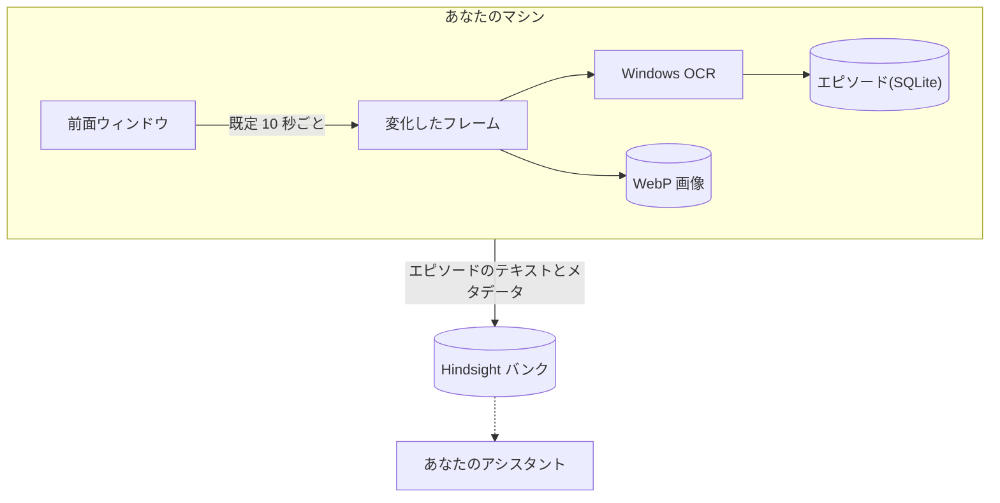

# ContextWitness

[](https://github.com/Skyzi000/contextwitness/actions/workflows/ci.yml)
[](LICENSE)


[English](README.md) | 日本語

**PC 上での人の活動を、AI が参照できる記憶にする Windows 常駐デーモンです。**

目指しているのは、PC 上での活動すべてを記憶にすることです。v1 はその最初の一歩として、画面を記録します。前面ウィンドウを一定間隔でキャプチャし、Windows OCR で文字を読み取り、時刻つきのエピソードにまとめて、[Hindsight](https://github.com/vectorize-io/hindsight) のメモリバンクへ配送します。そのバンクにつないだアシスタントは「火曜の午後は何をしてた?」のような質問に答えられるようになります。

> [!IMPORTANT]
> ContextWitness は画面を記録します。実行する前に[プライバシー](#プライバシー)を読んでください。

## 仕組み



## 動作要件

- **Windows 11 24H2**(ビルド 26100)以降。
- エピソードを配送するには、稼働している [Hindsight](https://github.com/vectorize-io/hindsight) サーバー(**v0.8.6** 以降)。

## インストール

次のどちらかで入れます:

- **Portable ZIP** — [Releases](https://github.com/Skyzi000/contextwitness/releases) から `contextwitness-vX.Y.Z-windows-x86_64.zip` をダウンロードして、任意の場所へ展開します。
- **ソースから** — `cargo install --git https://github.com/Skyzi000/contextwitness cw-daemon`(Rust の MSVC ツールチェーンが必要)。`contextwitness` コマンドが入ります。

バイナリは署名なしのオープンソースビルドのため、初回実行時に Windows SmartScreen が警告することがあります。

## クイックスタート

ZIP 版は PATH に登録されません。以下の `contextwitness` を `.\contextwitness.exe` に読み替え、`contextwitness.exe` のあるフォルダで実行してください。

```text
contextwitness setup
contextwitness run
```

`setup` は Hindsight API URL・API トークン(任意)・データディレクトリを尋ねて書き込みます。`run` はトレイアイコンを出してキャプチャを開始し、トレイメニューの Quit で終了するまで動き続けます。

エピソードは Hindsight の `contextwitness` バンクへ配送されます。バンクが無ければ自動で作成します([Hindsight バンク](#hindsight-バンク)を参照)。動作状況は、別のターミナルで `contextwitness status` を実行すると確認できます。

### その他のコマンド

| コマンド | 内容 |
| --- | --- |
| `status` | 現在の動作状況を 1 画面で表示する。 |
| `pause [30m\|2h\|...]` | キャプチャを一時停止する。時間を指定しなければ `resume` するまで。 |
| `resume` | キャプチャを再開する。 |
| `defaults` | 全設定の既定値と意味を表示する。 |
| `autostart enable\|disable` | ログオン時の自動起動。 |
| `capture-once` | 動作確認用に 1 回だけキャプチャする。一時停止中でも実行される。 |

## v1 でできること

- **キャプチャ。** 前面ウィンドウを一定間隔(既定 10 秒)で Windows Graphics Capture を使ってキャプチャし、一定量を超えるピクセルが変化したときだけフレームを保存します。他のウィンドウとモニターはキャプチャしません。前面ウィンドウの上に別のウィンドウが重なっていても、写るのは前面ウィンドウの内容で、重なったウィンドウは写りません。
- **OCR。** 画面上のテキストを Windows OCR エンジンで抽出します。設定した言語のうちインストール済みエンジンが存在する最初のものを使います(既定は日本語→英語の順)。
- **エピソード。** キャプチャを一定時間(既定 5 分)ごとに 1 つのエピソードへまとめ、時刻つきの活動ログにします。同じエピソードの中で同じウィンドウを再びキャプチャしたときは、前回のキャプチャとの差分のほうが短ければ、差分で記録します。それ以外は全文を記録します。
- **フレームの無い時間。** フレームを保存しなかった時間帯も、その状態をエピソードに残します。保存するほどの変化が無かった、新しいフレームが届かなかった、キャプチャできる前面ウィンドウが無かった、一時停止していた、ブラックリストでスキップした、キャプチャや保存に失敗した(エラー文つき)、といった状態です。記録が途切れていた時間も、途切れとして残します。
- **ローカル優先。** すべてをまずローカルへ保存します。エピソードは SQLite に、フレームは WebP 画像として保存し、画像は既定で 14 日・50 GiB まで保持します。
- **配送。** エピソードを Hindsight へ配送します。未配送のエピソードはローカルに保存されているので、サーバーが落ちている間は待機し、復帰後に配送されます。
- **トレイ。** トレイアイコン付きで常駐します。一時停止と再開は、トレイからもコマンドラインからもできます。ログオン時の自動起動は任意です。

### エピソードの例

架空の内容で作ったエピソードです:

```text
[2026-07-25T01:00:00+09:00 - 2026-07-25T01:05:00+09:00] Screen episode

2026-07-25T01:00:01+09:00 [editor.exe] checklist.txt
  Release checklist
  1. Run the test suite
  2. Update the changelog
  3. Tag the release
  4. Publish the build
  Status: Open
  Owner: A
  Notes: none

2026-07-25T01:00:11+09:00 - 2026-07-25T01:01:31+09:00 [editor.exe] checklist.txt
  [no change above the capture threshold]

2026-07-25T01:01:41+09:00 [viewer.exe] diagram.png
  Figure 1: release flow

2026-07-25T01:02:11+09:00 [editor.exe] checklist.txt (changes since 2026-07-25T01:00:01+09:00)
  @@ -5,3 +5,3 @@
    4. Publish the build
  - Status: Open
  + Status: Done
    Owner: A

2026-07-25T01:02:21+09:00 - 2026-07-25T01:05:00+09:00
  [capture paused]
```

## プライバシー

ContextWitness は画面を記録します。実行する前に、次の点を確認してください:

- **既定では何も除外しません。** 前面ウィンドウに表示された内容は、機密情報も含めてすべて記録の対象です。別のウィンドウが重なって見えなくなっている部分も記録され、OCR が認識したテキストはすべて保存されます。各エントリには、取得できる限り、そのウィンドウのタイトルとプロセス名も記録されます。
- **ContextWitness が送る先は、設定した Hindsight サーバーだけです。** 送るのは、エピソードのテキスト(ウィンドウタイトル、プロセス名、キャプチャ状況の行とそのエラー文も入ります)と、そのメタデータ(エピソードの時刻とエントリ数)です。キャプチャ画像は送りません。Hindsight に届いたテキストがその先どこへ送られるかは、Hindsight の設定で決まります。Hindsight が外部の LLM や埋め込みサービスを使う設定なら、テキストはそこへも送られます。
- **`privacy.process_blacklist`** は、列挙したプロセス(実行ファイル名で照合、大文字小文字は区別しない)が前面にある間、キャプチャをスキップします。スキップしたことと、その原因になったプロセス名はエピソードに記録されます。ブラックリストを設定していて前面のプロセスを特定できなかったときも、その回のキャプチャをスキップします。
- **一時停止。** トレイメニューか `contextwitness pause 30m` でキャプチャを止められます(時間を指定しなければ `resume` するまで)。
- **画像の保持期間。** 保存した画像は、保持日数と総容量の上限に従って削除されます。対象は画像だけで、ローカルデータベースのエピソードテキストとログは自動では削除されません。
- **ログは機密情報です。** ログはデータディレクトリ(既定は `%LOCALAPPDATA%\ContextWitness`)の `logs` フォルダに保存され、ウィンドウタイトル・プロセス名・OCR テキストなど、キャプチャした内容が入ることがあります。たとえば、サーバーがエピソードを拒否すると、返ってきたエラー文にそのエピソードの内容が引用されていることがあり、それがログに記録されます。`contextwitness status` も直近の配送エラーを表示するので、その出力も同じように扱ってください。

## 設定

設定ファイルは `%APPDATA%\ContextWitness\config.toml` です。このファイルが無い状態で `setup` か `run` を実行すると、`storage.data_dir` と `hindsight.bank_id` だけを書いたものが作られます。書かれていない設定は、実行中のバージョンの既定値に従います。そのため、更新で既定値が変われば、それがそのまま適用されます。全設定の既定値は `contextwitness defaults` で表示できます。

設定は起動時に読み込まれるので、変更は起動し直すまで反映されません(ブラックリストへの追加も同じです)。変更したら、トレイメニューの Quit で終了し、`contextwitness run` で起動し直してください。

| キー | 既定値 | 意味 |
| --- | --- | --- |
| `capture.interval_secs` | `10` | キャプチャ試行の間隔秒数(1–30)。 |
| `capture.change_pixel_threshold` | `8` | ピクセルごとの輝度差がこの値以下なら「変化なし」と数える(0–254)。 |
| `capture.change_area_logical_pixels` | `600` | 変化した論理ピクセル数(表示スケーリング 100% 換算)がこれを超えたらフレームを保存して OCR する。 |
| `capture.webp_quality` | `75` | WebP エンコード品質(0–100)。 |
| `ocr.languages` | `["ja", "en"]` | OCR に使う言語の候補。先頭から順に試し、OCR エンジンがインストールされている最初の言語を使う。どの言語にも無ければ、Windows のユーザープロファイルの言語を使う。 |
| `storage.data_dir` | `""` | データディレクトリ。空なら `%LOCALAPPDATA%\ContextWitness`、それ以外は絶対パス。 |
| `storage.image_retention_days` | `14` | キャプチャ画像を保持する日数。 |
| `storage.image_retention_max_gib` | `50` | キャプチャ画像全体の容量上限(GiB)。 |
| `privacy.process_blacklist` | `[]` | 前面にある間はキャプチャしないプロセスの実行ファイル名。 |
| `hindsight.bank_id` | `"contextwitness"` | エピソードの配送先となる Hindsight バンク。[Hindsight バンク](#hindsight-バンク)を参照。 |
| `hindsight.context_label` | [下記参照](#context-ラベル) | 全エピソードに添えて送られる context ラベル。 |
| `episode.window_minutes` | `5` | 1 つのエピソードにまとめる時間の長さ(分、1–1440)。 |

### Hindsight バンク

エピソードは `hindsight.bank_id` のバンク(既定は `contextwitness`)へ配送されます。

- **バンクが無ければ自動で作ります。** 画面の OCR テキストに合わせた初期設定も一緒に入れます。これには Hindsight の bank config API(`HINDSIGHT_API_ENABLE_BANK_CONFIG_API`)が有効になっている必要があります。
- **すでにあるバンクの設定は変更しません。** Hindsight 側で変えた設定はそのまま残ります。
- **バンク ID は ContextWitness 専用にしてください。** 別のプログラムが同じ ID のバンクを同時に作ると、そのプログラムが作ったバンクに ContextWitness の初期設定が書き込まれることがあります。

初期設定の中身と、bank config API が無効な場合の手順は[バンク初期化の詳細](#バンク初期化の詳細)にあります。

### context ラベル

`hindsight.context_label` は、各エピソードに添えて Hindsight へ送る説明文です。記憶と一緒に保存され、記憶を読むアシスタントに、そのテキストが何で、どう読めばよいかを伝えます。通常は変更する必要はありません。`config.toml` に書かなければ、実行中のバージョンの既定値が使われます。

既定値:

> Time-stamped OCR text of the foreground window, with its application and window title where known. An entry headed (changes since \<time\>) is a unified diff of OCR lines against that window's entry at \<time\>: to read that entry, call list_memories with q set to \<time\> (a substring search, not relevance-ranked recall) and use the entry headed by that time in the same document, repeating while it is itself a change entry. May contain OCR errors; shows what was displayed, not what the user read, wrote, or did.

### 資格情報

Hindsight の資格情報(API URL とトークン)は `config.toml` には書きません。次のどちらか一方から読みます:

- **ファイル。** `setup` が `%USERPROFILE%\.hindsight\contextwitness.json` に保存します。
- **環境変数。** `CONTEXTWITNESS_HINDSIGHT_URL` と、トークンが必要なら `CONTEXTWITNESS_HINDSIGHT_TOKEN`。URL の環境変数が設定されているときは環境変数だけを使い、ファイルは読みません。

ファイルと環境変数を組み合わせることはできません。トークンの環境変数だけを設定するとエラーになります。

## 更新とアンインストール

**更新。** トレイメニューの Quit で終了してから、新しい版の `contextwitness.exe` に切り替えます。自動起動は、登録したときの `contextwitness.exe` の場所を指しています。ZIP は版ごとに別の名前のフォルダへ展開されるので、場所が変わったときは、新しい `contextwitness.exe` で `autostart enable` をもう一度実行してください。

**アンインストール。** 次の順に行います:

1. 自動起動を登録している場合は、`contextwitness autostart disable` で解除します。
2. トレイメニューの Quit で終了し、`contextwitness.exe` を削除します(ソースから入れた場合は `cargo uninstall cw-daemon`)。

`contextwitness.exe` を削除しても、次のものは残ります。不要なら削除してください:

- **ローカルの記録。** エピソード・画像・ログ。データディレクトリ(既定は `%LOCALAPPDATA%\ContextWitness`)にあります。
- **設定。** `%APPDATA%\ContextWitness\config.toml`。
- **資格情報。** `%USERPROFILE%\.hindsight\contextwitness.json`。
- **Hindsight へ配送済みの記憶。** Hindsight サーバーのバンクに残ります。消すには、Hindsight 側でバンクを削除します。

## バンク初期化の詳細

Hindsight の設定を自分で管理する人向けの説明です。

ContextWitness は、Hindsight のバンク一覧で `hindsight.bank_id` を探します。一覧で存在を確認できたバンクの設定は変更しません。見つからなければ、bank config への PATCH 1 回でバンクを作成し、次の 3 項目だけを設定します。他の設定は Hindsight サーバー側の設定を引き継ぎます。

- `retain_extraction_mode="chunks"` — エピソードを LLM 抽出ではなく原文チャンクとして保存
- `store_document_text=false` — 同じテキストを Hindsight に二重に保存しない
- `observations_mission` — 元のテキストが画面の OCR であることを Hindsight に伝える説明文

**bank config API が無効なとき。** バンクの自動作成には Hindsight の bank config API(`HINDSIGHT_API_ENABLE_BANK_CONFIG_API`)が必要です。無効な場合は、Hindsight 側であらかじめバンクを作成し、設定を済ませておいてください。ContextWitness はそのバンクの設定を変更せずに配送します。

**同時作成。** ContextWitness がバンクの不在を確認した直後に、別のプログラムが同じ ID のバンクを作ると、そのバンクにも上の 3 項目が 1 回書き込まれます。バンク ID を専用にするのはこのためです。

**`store_document_text=false` の意味。** 同じテキストを Hindsight に二重に保存しないための設定です。`chunks` モードでは、エピソードの原文はチャンクに分割され、そのまま記憶として保存されるので、全文が Hindsight に残ります。Hindsight はそれとは別に原文の写しも保存できますが、中身が記憶と重複するため、保存しない設定にしています。その代わり、この写しを読む Hindsight の機能(文書・チャンク本文の取得、Reflect の expand、保存した原文からの再処理)は使えません。原文は ContextWitness のローカルデータベースにも残ります。

## ライセンス

[MIT](LICENSE)
