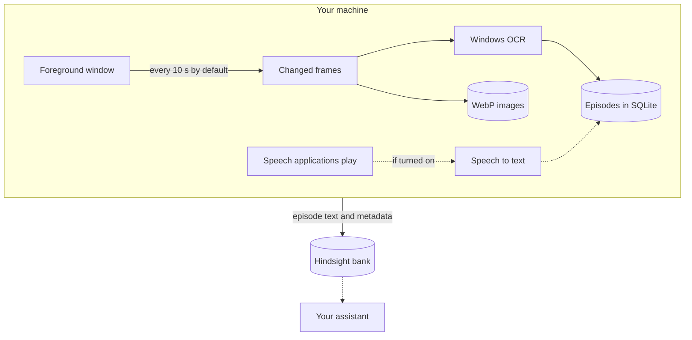

# ContextWitness

[](https://github.com/Skyzi000/contextwitness/actions/workflows/ci.yml)
[](LICENSE)


English | [日本語](README.ja.md)

**A Windows daemon that turns what you do on your PC into memory an AI can consult.**

The goal is a memory of everything you do on the machine. Today it records two things: the screen, and — once you turn it on — the speech your applications play. It captures the foreground window on a fixed cadence and reads the frames with Windows OCR; with audio recording on, it also turns that speech into text, without keeping the audio. What it saw and heard is grouped into time-anchored episodes and delivered to a [Hindsight](https://github.com/vectorize-io/hindsight) memory bank — so an assistant wired to that bank can answer questions like "what was I working on Tuesday afternoon?".

> [!IMPORTANT]
> ContextWitness records the screen. With audio recording turned on — it is off by default — it also records the speech your applications play, as text. Read [Privacy](#privacy) before running it.

## How it works



The speech path is [audio recording](#audio-recording), which you turn on yourself. Speech is turned into text on your machine unless you choose a transcription API, which then receives the audio.

## Requirements

- **Windows 11 24H2** (build 26100) or later.
- A running [Hindsight](https://github.com/vectorize-io/hindsight) server, **v0.8.6** or later, to deliver episodes to.

## Install

Either:

- **Portable ZIP** — download `contextwitness-vX.Y.Z-windows-x86_64.zip` from [Releases](https://github.com/Skyzi000/contextwitness/releases) and unzip it anywhere.
- **From source** — follow [Building from source](#building-from-source) (needs the Rust MSVC toolchain); this installs the `contextwitness` command.

The binaries are unsigned open-source builds, so Windows SmartScreen may warn the first time you run one.

## Quickstart

The ZIP adds nothing to PATH: run the commands below from the folder that holds `contextwitness.exe`, reading `contextwitness` as `.\contextwitness.exe`.

```text
contextwitness setup
contextwitness run
```

`setup` asks for the Hindsight API URL, an optional API token, and the data directory, and writes them. `run` starts capturing with the tray icon up and keeps running until you choose Quit from the tray menu.

Episodes go to a Hindsight bank named `contextwitness`, which is created automatically if it does not exist (see [Hindsight bank](#hindsight-bank)). To check that it is working, run `contextwitness status` in another terminal.

To record the speech your applications play as well, see [Turning on audio recording](#turning-on-audio-recording).

### Other commands

| Command | What it does |
| --- | --- |
| `status` | One-screen summary of what this installation is doing. |
| `pause [30m\|2h\|...]` | Stops recording, screen and audio; no duration means until `resume`. |
| `resume` | Starts recording again. |
| `defaults` | Prints every setting with its built-in default and meaning, and the mission given to the Hindsight bank. |
| `autostart enable\|disable` | Start at logon. |
| `capture-once` | One manual screen capture pass, for checking the pipeline; it ignores `pause`. |

## What it does

- **Capture.** Captures the foreground window at a fixed interval (10 seconds by default) with Windows Graphics Capture, storing a frame only when enough pixels actually changed. Other windows and monitors are not captured. If another window overlaps the foreground window, what is captured is still the foreground window's own content, not the overlapping window.
- **OCR.** Extracts on-screen text with the Windows OCR engine, using the first configured language an installed engine exists for (Japanese, then English, by default).
- **Episodes.** Groups captures into episode windows (5 minutes by default) rendered as a time-anchored activity log. A window captured again within an episode is logged as a diff against its previous capture when the diff is shorter, and in full otherwise.
- **Gaps.** The time between stored frames is logged too: no change above the capture threshold, no new frame received, no capturable foreground window, paused, skipped by the blacklist, capture or storage failures with their error text, and stretches with nothing recorded.
- **Audio (optional).** Transcribes the speech applications play and delivers the text as audio episodes, separate from the screen ones. See [Audio recording](#audio-recording).
- **Local first.** Stores everything locally first: episodes in SQLite, frames as WebP images with retention limits (14 days / 50 GiB by default).
- **Delivery.** Delivers episodes to Hindsight through a persistent outbox: if the server is down, episodes wait and are delivered when it returns.
- **Tray.** Runs with a tray icon; `pause`/`resume` from the tray or the command line; optional start at logon.

### What an episode looks like

A screen episode with made-up content:

```text
[2026-07-25T01:00:00+09:00 - 2026-07-25T01:05:00+09:00] Screen episode

2026-07-25T01:00:01+09:00 [editor.exe] checklist.txt
  Release checklist
  1. Run the test suite
  2. Update the changelog
  3. Tag the release
  4. Publish the build
  Status: Open
  Owner: A
  Notes: none

2026-07-25T01:00:11+09:00 - 2026-07-25T01:01:31+09:00 [editor.exe] checklist.txt
  [no change above the capture threshold]

2026-07-25T01:01:41+09:00 [viewer.exe] diagram.png
  Figure 1: release flow

2026-07-25T01:02:11+09:00 [editor.exe] checklist.txt (changes since 2026-07-25T01:00:01+09:00)
  @@ -5,3 +5,3 @@
    4. Publish the build
  - Status: Open
  + Status: Done
    Owner: A

2026-07-25T01:02:21+09:00 - 2026-07-25T01:05:00+09:00
  [capture paused]
```

## Audio recording

Audio recording is optional and off by default. Turned on, it records the speech that applications play on this PC — in a call, a video or a game, for example — as text.

- **What is recorded.** The sound applications play. Each application that is playing sound is recorded separately, and only what is detected as speech is turned into text, one stretch of speech (an utterance) at a time. Recording of an application begins shortly after it starts to play, usually within about a second, so the very beginning can be missing.
- **The audio is not stored.** It is held in memory until it has been transcribed and is not written to disk. What is stored and delivered is the text.
- **Where the text comes from.** By default a model you download runs on this PC, and the audio does not leave it. You can use a transcription API instead; then the audio of each utterance is sent to that API.
- **Transcripts contain mistakes.** They are machine transcription: words are misheard, names especially, and nothing tells who is speaking.
- **Audio episodes.** Transcripts are grouped into the same episode windows as the screen (5 minutes by default) and delivered as documents of their own, separate from the screen episodes. A window gets an audio episode only if speech was captured in it.
- **What it costs.** Audio recording runs in a process of its own. With a local model, that process keeps the model in memory for as long as it runs, and uses the CPU while speech is playing.

How to turn it on is under [Turning on audio recording](#turning-on-audio-recording); what it means for privacy is under [Privacy](#privacy).

### What an audio episode looks like

An audio episode with made-up content:

```text
[2026-07-25T01:00:00+09:00 - 2026-07-25T01:05:00+09:00] Audio episode

2026-07-25T01:00:12+09:00 - 2026-07-25T01:01:40+09:00 [talk.exe]
  01:00:12 Is the checklist for next week's release done?
  01:00:19 Yes, only the announcement is left.
  01:01:36 Then let's ship it on Friday.

2026-07-25T01:00:21+09:00 - 2026-07-25T01:00:39+09:00 [player.exe]
  01:00:21 Figure one shows the release flow.
  01:00:34 [transcription failed: HTTP 503 Service Unavailable]

2026-07-25T01:00:45+09:00 - 2026-07-25T01:01:20+09:00
  [audio capture skipped by the process blacklist: vault.exe]

2026-07-25T01:02:21+09:00 - 2026-07-25T01:05:00+09:00
  [audio capture pause requested for this period]
```

- **An entry gathers utterances of one application.** Its header gives the time range of those utterances and the executable the audio was captured from. When that application is itself playing sound, speech from programs it started is recorded under its name too. Entries of different applications can overlap in time, as the two above do.
- **A line is one utterance**, beginning with the local time it started.
- **A bracketed line** stands for an utterance that could not be transcribed, with the reason — here, the status a transcription API answered with.
- **`[audio capture skipped by the process blacklist: …]`** marks a stretch over which audio was not recorded because of a program on the blacklist, which it names.
- **`[audio capture pause requested for this period]`** marks a stretch over which a pause was in force, from when it was asked for until it was lifted or ran out. Recording stops about a second after it is asked to, so an utterance from the start of the stretch can still appear.

## Privacy

ContextWitness records the screen and, with audio recording on, the speech your applications play. Know what that means before running it:

- **Nothing is excluded by default.** Whatever the foreground window shows is recorded, confidential information included. Parts of it that other windows cover are captured too; all text OCR recognizes in it is stored, and each entry records the window's title and process name whenever they can be read.
- **ContextWitness sends only to servers you configured.** To your Hindsight server it sends episode text — window titles, process names and capture status lines with their error text included — and its metadata (episode timing and entry count). The captured images themselves are never uploaded. Where the text goes from Hindsight is up to Hindsight's configuration: if it is set up to use an external LLM or embedding service, the text is sent on to that service. What audio recording adds is under [With audio recording on](#with-audio-recording-on).
- **`privacy.process_blacklist`** skips capture while a listed process (matched by executable name, case-insensitively) is in the foreground; the episode still records the skip and the process name that caused it. When a blacklist is configured and the foreground process cannot be determined, that capture is skipped too. For audio the list reaches further: see [With audio recording on](#with-audio-recording-on).
- **Pause** stops recording, screen and audio: from the tray menu, or `contextwitness pause 30m` (no duration means until `resume`).
- **Retention** prunes stored images by age and total size. It covers images only; episode text in the local database, transcripts included, and the logs are not deleted automatically.
- **Logs are confidential.** They are written to the `logs` folder of the data directory (`%LOCALAPPDATA%\ContextWitness` by default) and can contain captured content — window titles, process names, OCR text, transcripts — for example where delivery diagnostics quote server-returned error text, which can quote a refused episode back. `contextwitness status` reprints the delivery error carried by the newest affected episode; treat its output the same way.

### With audio recording on

Turning audio recording on adds the following:

- **All speech that applications play is recorded.** The other side of a call, the audio of a video or a game: whatever is played is transcribed, confidential information included, and stored with the time and the name of the application's executable. The audio itself is not stored; it is held in memory only until it has been transcribed.
- **Where it is sent.** While a model on this PC does the transcription, the audio is sent nowhere. With a transcription API, the audio of each utterance is sent to the API you configured. The transcripts go to Hindsight like the screen text, with the executable names and the times.
- **Put what you do not want recorded on the blacklist.** Audio from a program listed in `privacy.process_blacklist` is not recorded, whether or not it is in the foreground. Neither is audio from:
  - a program it started, directly or through other programs;
  - an application it is running under, for as long as it runs there.

  While a blacklist is set, a program whose name cannot be read is not recorded either. The stretches that were skipped are noted in the audio episode, with the name of the listed program.
- **What the blacklist does not catch.**
  - The moment after a listed program starts under an application that is already being recorded: up to about a second of audio can still be transcribed.
  - A program that a listed program started, once the listed program itself has exited: it is recorded like any other.
- **Pause does not stop audio at once.** It takes about a second. An utterance still in progress then is thrown away; utterances that had already ended are still transcribed and stored, which with a transcription API means their audio is still sent.
- **What goes to the log.** The names of the applications recorded, the length of each utterance and the number of characters in its transcript, and the reason when a transcription fails, with the start of the API's answer when an API refused the request. The transcript text is not logged.

## Configuration

The configuration file is `%APPDATA%\ContextWitness\config.toml`. The first time `setup` or `run` needs it, it is written holding only `storage.data_dir` and `hindsight.bank_id`; a setting it leaves out follows the built-in default of the running version, so a later version's defaults reach it. `contextwitness defaults` prints every setting with its default.

Settings are read at startup, so a change — an addition to the blacklist included — takes effect only after a restart: choose Quit from the tray menu, then run `contextwitness run` again.

The defaults:

| Key | Default | Meaning |
| --- | --- | --- |
| `capture.interval_secs` | `10` | Seconds between capture attempts (1–30). |
| `capture.change_pixel_threshold` | `8` | Per-pixel luma delta at or below which a pixel counts as unchanged (0–254). |
| `capture.change_area_logical_pixels` | `600` | Store and OCR a frame once more than this many logical pixels (measured at 100% display scaling) changed. |
| `capture.webp_quality` | `75` | WebP encoding quality (0–100). |
| `ocr.languages` | `["ja", "en"]` | OCR languages to try, in order. The first one with an installed OCR engine is used; when none has one, your Windows profile languages are. |
| `audio.enabled` | `false` | Record the speech applications play, as text. See [Turning on audio recording](#turning-on-audio-recording). |
| `audio.backend` | `"local"` | What turns speech into text: `"local"` (a model on this PC) or `"api"` (a transcription API). |
| `audio.model_dir` | `""` | For `"local"`: the folder holding the model; empty means the model in the data directory's `models` folder, otherwise an absolute path. |
| `audio.api_model` | `""` | For `"api"`: the model name to request. |
| `audio.language` | `""` | Language of the speech, e.g. `"ja"`; empty lets the transcriber detect it. |
| `storage.data_dir` | `""` | Data directory; empty means `%LOCALAPPDATA%\ContextWitness`, otherwise an absolute path. |
| `storage.image_retention_days` | `14` | Days to keep captured images. |
| `storage.image_retention_max_gib` | `50` | Total captured-image storage cap in GiB. |
| `privacy.process_blacklist` | `[]` | Executable names whose screen and audio are not recorded, e.g. `["vault.exe"]`. See [Privacy](#privacy). |
| `hindsight.bank_id` | `"contextwitness"` | Hindsight bank the episodes go to. See [Hindsight bank](#hindsight-bank). |
| `hindsight.context_label` | See [Context label](#context-label). | Context label sent with every screen episode. |
| `hindsight.audio_context_label` | See [Audio context label](#audio-context-label). | Context label sent with every audio episode. |
| `episode.window_minutes` | `5` | Length of an episode window in minutes (1–1440). |

### Turning on audio recording

Audio recording is off until `audio.enabled` is `true`, and it needs something that turns speech into text. `audio.backend` chooses it: a model that runs on this PC (`"local"`, the default) or a transcription API (`"api"`). Read [Privacy](#privacy) before turning it on, [With audio recording on](#with-audio-recording-on) included.

**With a model on this PC.** ContextWitness does not come with a model. It reads SenseVoice models in the form the [sherpa-onnx](https://github.com/k2-fsa/sherpa-onnx) project publishes them; the one it is tested with is `sherpa-onnx-sense-voice-zh-en-ja-ko-yue-int8-2024-07-17`, which covers Chinese, Cantonese, English, Japanese and Korean.

The model is published by others under its own license, not ContextWitness's. The `LICENSE` file inside it refers to the [license section of the FunASR repository](https://github.com/modelscope/FunASR?tab=readme-ov-file#license), which says that model weights are licensed separately from the code and points to the [FunASR Model Open Source License Agreement](https://github.com/modelscope/FunASR/blob/main/MODEL_LICENSE). Read it before using the model.

1. Download [`sherpa-onnx-sense-voice-zh-en-ja-ko-yue-int8-2024-07-17.tar.bz2`](https://github.com/k2-fsa/sherpa-onnx/releases/download/asr-models/sherpa-onnx-sense-voice-zh-en-ja-ko-yue-int8-2024-07-17.tar.bz2) (about 160 MB) from the [`asr-models` release](https://github.com/k2-fsa/sherpa-onnx/releases/tag/asr-models) of sherpa-onnx.
2. Unpack it. Windows' own `tar` reads this format: in a terminal opened in the folder that holds the file, run `tar -xf sherpa-onnx-sense-voice-zh-en-ja-ko-yue-int8-2024-07-17.tar.bz2`. The result is a folder of the same name, about 240 MB.
3. Move that folder, under the same name, into `models` in the data directory: `%LOCALAPPDATA%\ContextWitness\models` unless you changed `storage.data_dir`. ContextWitness creates `models` when it starts.
4. Add this to `config.toml`:

   ```toml
   [audio]
   enabled = true
   ```

5. Restart ContextWitness: choose Quit from the tray menu, then run `contextwitness run` again.
6. Check that it runs: `contextwitness status` has an `audio worker` line, which shows a time that keeps advancing, a little behind the clock. If it stays at `never` or stops advancing, see [Audio recording in detail](#audio-recording-in-detail).

To keep the model in another folder, or to use a different SenseVoice model, set `audio.model_dir` to the absolute path of the folder holding `model.int8.onnx` and `tokens.txt`. Single quotes keep the backslashes as they are: `model_dir = 'C:\Models\sense-voice'`.

**With a transcription API instead.** The API has to be OpenAI-compatible: ContextWitness sends each utterance in a POST to `<api_url>/audio/transcriptions` and reads the `text` field of the JSON answer.

1. Write the API's URL, and its key if it needs one, to `%APPDATA%\ContextWitness\credentials.toml`, next to `config.toml`. They never live in `config.toml`, and `setup` does not ask for them.

   ```toml
   [transcription]
   api_url = "https://transcription.example/v1"
   api_key = "your-key"
   ```

2. Add this to `config.toml`. `audio.api_model` is the model name the API is asked for; leave it out if the API needs none.

   ```toml
   [audio]
   enabled = true
   backend = "api"
   api_model = "your-model-name"
   ```

3. Restart ContextWitness, then check the `audio worker` line as in step 6 above.

Environment variables can stand in for the file: `CONTEXTWITNESS_TRANSCRIPTION_URL`, plus `CONTEXTWITNESS_TRANSCRIPTION_KEY` if a key is needed. When the URL variable is set, only the environment is used and the file is not read. The two are never combined: setting the key variable without the URL variable is an error, and so is a file that holds a key without a URL. What the API receives is in [Audio recording in detail](#audio-recording-in-detail).

### Hindsight bank

Episodes go to the bank `hindsight.bank_id` names (`contextwitness` by default).

- **A missing bank is created for you**, with initial settings suited to the text ContextWitness sends: screen OCR text and audio transcripts. This needs Hindsight's bank config API (`HINDSIGHT_API_ENABLE_BANK_CONFIG_API`) to be enabled.
- **An existing bank keeps its settings, with one exception.** What you change in Hindsight stays as you set it. The exception is the `observations_mission` that ContextWitness itself wrote: when a new version changes what the episodes look like, it replaces that text with its own. A mission you wrote is not touched.
- **Keep the bank id to ContextWitness.** If another program creates a bank with the same id at the same moment, the bank it created can receive ContextWitness's initial settings.

What the initial settings are, when the mission is replaced, and what to do when the bank config API is disabled, is in [Bank initialization in detail](#bank-initialization-in-detail).

### Context label

`hindsight.context_label` is a description sent to Hindsight with every screen episode. It is stored with the memories and tells the assistant reading them what the text is and how to read it. You normally do not need to change it; left out of `config.toml`, it follows the default of the running version.

The default:

> Time-stamped OCR text of the foreground window, with its application and window title where known. An entry headed (changes since \<time\>) is a unified diff of OCR lines against that window's entry at \<time\>: to read that entry, call list_memories with q set to \<time\> (a substring search, not relevance-ranked recall) and use the entry headed by that time in the same document, repeating while it is itself a change entry. May contain OCR errors; shows what was displayed, not what the user read, wrote, or did.

### Audio context label

`hindsight.audio_context_label` is the same kind of description for audio episodes: it is sent with every audio episode and tells the assistant that the text is machine transcription and how an entry is laid out. You normally do not need to change it; left out of `config.toml`, it follows the default of the running version.

The default:

> Machine transcripts of speech that applications played on this PC. Each entry is headed by a time range and the application the audio was captured from, which can include sound from programs that application started; each line begins with the local time its utterance started. Expect misheard words, especially names. Shows what was played, not what the user listened to or did.

### Credentials

Hindsight credentials (the API URL and token) never live in `config.toml`. They are read from one of two places:

- **The file.** `setup` writes them to `%USERPROFILE%\.hindsight\contextwitness.json`.
- **Environment variables.** `CONTEXTWITNESS_HINDSIGHT_URL`, plus `CONTEXTWITNESS_HINDSIGHT_TOKEN` if a token is needed. When the URL variable is set, only the environment is used and the file is not read.

The two are never combined: setting the token variable without the URL variable is an error.

The URL and key of a transcription API, needed only with `audio.backend = "api"`, are kept apart from these: see [Turning on audio recording](#turning-on-audio-recording).

## Updating and uninstalling

**Updating.** Quit from the tray menu, then switch to the new version's `contextwitness.exe`. Start at logon points at where `contextwitness.exe` was when you enabled it. Each version's ZIP unpacks into a differently named folder, so when the location changes, run `autostart enable` again with the new `contextwitness.exe`. Audio recording is off by default, so updating from a version without it does not turn it on. Read [CHANGELOG](CHANGELOG.md) first: it says when a version migrates the database. For a source install, see [Building from source](#building-from-source).

**Uninstalling.** In this order:

1. If you enabled start at logon, remove it with `contextwitness autostart disable`.
2. Quit from the tray menu and delete `contextwitness.exe` (for a source install, `cargo uninstall cw-daemon`).

Deleting `contextwitness.exe` leaves the following behind. Delete what you no longer want:

- **Local records.** Episodes, images and logs, in the data directory (`%LOCALAPPDATA%\ContextWitness` by default). If audio recording was on, the data directory also holds `silero_vad.onnx`, a small file ContextWitness writes there to detect speech.
- **Settings.** `%APPDATA%\ContextWitness\config.toml`.
- **Credentials.** `%USERPROFILE%\.hindsight\contextwitness.json`, and `%APPDATA%\ContextWitness\credentials.toml` if you wrote one.
- **The transcription model.** In `models` in the data directory, or in the folder `audio.model_dir` names.
- **Memories already delivered to Hindsight.** They stay in the bank on the Hindsight server; to remove them, delete the bank on the Hindsight side.
- **The checkout, for a source install.** The folder you cloned, with what was fetched and built in it.

## Building from source

A build needs Git and the Rust MSVC toolchain. `cargo install --git` on its own does not work for this repository: the build links prebuilt native libraries and embeds a small speech-detection model, and a script has to fetch both into the checkout first. In PowerShell or Command Prompt:

```text
git clone https://github.com/Skyzi000/contextwitness
cd contextwitness
powershell -ExecutionPolicy Bypass -File scripts/fetch-sherpa-onnx.ps1
cargo install --path crates/cw-daemon
```

The script downloads two files from the [sherpa-onnx](https://github.com/k2-fsa/sherpa-onnx) releases on GitHub — its static libraries (about 120 MB, about 1 GB unpacked) and the speech-detection model (under 1 MB) — checks each against a pinned SHA-256, and puts them under `target\vendor`. It does nothing when they are already in place. `cargo install` then builds in the checkout and installs the `contextwitness` command. Without the fetched files the build stops with an error; `cargo clean` removes them, so run the script again after it.

To update a source install, run `git pull` in the checkout, then the last two commands again.

## Audio recording in detail

For those who use a transcription API, or whose audio recording does not run.

**What a transcription API receives.** Each request carries the audio of one utterance as a WAV file (16 kHz, mono), the model name and `audio.language` when they are set, and the key if there is one. A request that fails in a way that may pass — a connection error, a server error, a rate limit — is tried up to three times in all. An utterance that still fails is recorded as a `[transcription failed: …]` line. Its reason is short: the HTTP status the API answered with, the connection error without the URL, or a note such as a backlog that is full. The API's own error text goes to the log, not into the episode.

**When audio recording does not run.** ContextWitness keeps running and keeps recording the screen; only audio recording stops. It is started again after 5 seconds, then after waits that double each time up to 5 minutes, and each attempt writes its reason to the log, on lines containing `audio worker`. What to check:

- **The model is not in place, or the API's URL is missing.** Put the model in place or correct the setting, then restart ContextWitness.
- **The model is in place and still does not load.** The path to its folder may be too long. Move the folder to a shorter path.

An `audio.model_dir` that is not an absolute path is a different case: like any invalid setting, it keeps ContextWitness from starting at all.

**When the `audio worker` time stops advancing.** Audio recording is not running — or, with a transcription API that is slow or failing, it is still waiting on utterances it has not finished. While it runs, each utterance that is stored adds a `stored utterance` line to the log, with the application's name, the utterance's length and the number of characters.

## Bank initialization in detail

For those who manage their Hindsight configuration themselves.

ContextWitness looks for `hindsight.bank_id` in Hindsight's bank list. For a bank the list confirms as existing, the settings are left unchanged, apart from a mission ContextWitness wrote earlier (see below). When the list shows none, one PATCH to the bank config creates the bank and sets three things; every other setting follows the Hindsight server's own configuration:

- `retain_extraction_mode="chunks"` — episodes are stored as raw text chunks instead of LLM-extracted facts
- `store_document_text=false` — the same text is not stored in Hindsight twice
- `observations_mission` — tells Hindsight what the text is: OCR of the screen, and transcripts of speech that applications played

**When the mission is replaced.** Each time it starts, before its first delivery, ContextWitness reads the bank's `observations_mission`. If that is exactly the text ContextWitness last wrote there, or the text version 1.0.0 wrote, it replaces it with the current version's; no other setting is sent. Any other text, one you wrote or one another program set, is left as it is. Either way the log says so. To bring a mission of your own up to date by hand, `contextwitness defaults` prints the current text at its end.

**When the bank config API is disabled.** Creating the bank requires Hindsight's bank config API (`HINDSIGHT_API_ENABLE_BANK_CONFIG_API`). Where it is disabled, create the bank and configure it on the Hindsight side beforehand; ContextWitness then delivers without changing its settings. It cannot replace the mission there either: when Hindsight refuses, the log says so, and the current text, which `contextwitness defaults` prints, has to be put in by hand.

**Concurrent creation.** If another program creates a bank with the same id just after ContextWitness found none, that bank also receives the three settings above, once. This is why the bank id should be ContextWitness's own.

**What `store_document_text=false` means.** It keeps Hindsight from storing the same text twice. In `chunks` mode an episode's text is split into chunks and each chunk is stored as a memory as it is, so the whole text stays in Hindsight. Hindsight can also keep a separate copy of the original text, but that copy would only duplicate the memories, so it is turned off. In exchange, the Hindsight features that read that copy are unavailable: document and chunk text retrieval, Reflect's expand, and re-processing from the stored source text. The text also remains in ContextWitness's local database.

## License

[MIT](LICENSE)

`contextwitness.exe` contains third-party software. The ZIP carries its notices: `THIRD-PARTY-LICENSES.txt` for the Rust crates, `RUST-STD-COPYRIGHT.html` for the Rust standard library, and [`THIRD-PARTY-NATIVE-LICENSES.txt`](THIRD-PARTY-NATIVE-LICENSES.txt) for the native speech libraries and the speech-detection model. The transcription model is not part of ContextWitness and has its own license (see [Turning on audio recording](#turning-on-audio-recording)).
