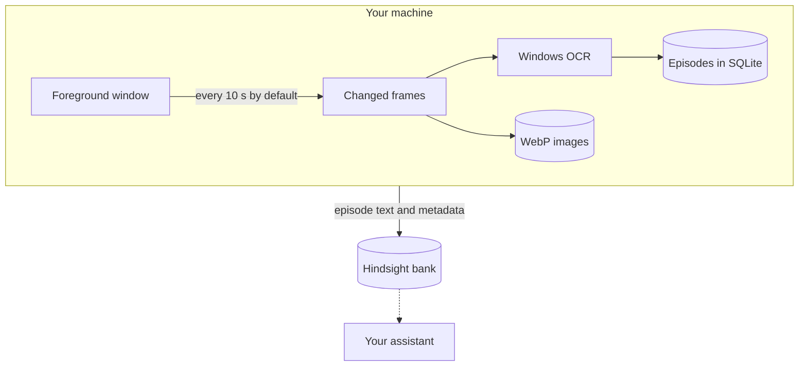

# ContextWitness

[](https://github.com/Skyzi000/contextwitness/actions/workflows/ci.yml)
[](LICENSE)


English | [日本語](README.ja.md)

**A Windows daemon that turns what you do on your PC into memory an AI can consult.**

The goal is a memory of everything you do on the machine; v1 is the first step, and what it records is the screen. It captures the foreground window on a fixed cadence, reads the frames with Windows OCR, groups what it saw into time-anchored episodes, and delivers them to a [Hindsight](https://github.com/vectorize-io/hindsight) memory bank — so an assistant wired to that bank can answer questions like "what was I working on Tuesday afternoon?".

> [!IMPORTANT]
> ContextWitness records the screen. Read [Privacy](#privacy) before running it.

## How it works



## Requirements

- **Windows 11 24H2** (build 26100) or later.
- A running [Hindsight](https://github.com/vectorize-io/hindsight) server, **v0.8.6** or later, to deliver episodes to.

## Install

Either:

- **Portable ZIP** — download `contextwitness-vX.Y.Z-windows-x86_64.zip` from [Releases](https://github.com/Skyzi000/contextwitness/releases) and unzip it anywhere.
- **From source** — `cargo install --git https://github.com/Skyzi000/contextwitness cw-daemon` (needs the Rust MSVC toolchain); this installs the `contextwitness` command.

The binaries are unsigned open-source builds, so Windows SmartScreen may warn the first time you run one.

## Quickstart

The ZIP adds nothing to PATH: run the commands below from the folder that holds `contextwitness.exe`, reading `contextwitness` as `.\contextwitness.exe`.

```text
contextwitness setup
contextwitness run
```

`setup` asks for the Hindsight API URL, an optional API token, and the data directory, and writes them. `run` starts capturing with the tray icon up and keeps running until you choose Quit from the tray menu.

Episodes go to a Hindsight bank named `contextwitness`, which is created automatically if it does not exist (see [Hindsight bank](#hindsight-bank)). To check that it is working, run `contextwitness status` in another terminal.

### Other commands

| Command | What it does |
| --- | --- |
| `status` | One-screen summary of what this installation is doing. |
| `pause [30m\|2h\|...]` | Stops the capture loop; no duration means until `resume`. |
| `resume` | Starts capturing again. |
| `defaults` | Prints every setting with its built-in default and meaning. |
| `autostart enable\|disable` | Start at logon. |
| `capture-once` | One manual capture pass, for checking the pipeline; it ignores `pause`. |

## What v1 does

- **Capture.** Captures the foreground window at a fixed interval (10 seconds by default) with Windows Graphics Capture, storing a frame only when enough pixels actually changed. Other windows and monitors are not captured. If another window overlaps the foreground window, what is captured is still the foreground window's own content, not the overlapping window.
- **OCR.** Extracts on-screen text with the Windows OCR engine, using the first configured language an installed engine exists for (Japanese, then English, by default).
- **Episodes.** Groups captures into episode windows (5 minutes by default) rendered as a time-anchored activity log. A window captured again within an episode is logged as a diff against its previous capture when the diff is shorter, and in full otherwise.
- **Gaps.** The time between stored frames is logged too: no change above the capture threshold, no new frame received, no capturable foreground window, paused, skipped by the blacklist, capture or storage failures with their error text, and stretches with nothing recorded.
- **Local first.** Stores everything locally first: episodes in SQLite, frames as WebP images with retention limits (14 days / 50 GiB by default).
- **Delivery.** Delivers episodes to Hindsight through a persistent outbox: if the server is down, episodes wait and are delivered when it returns.
- **Tray.** Runs with a tray icon; `pause`/`resume` from the tray or the command line; optional start at logon.

### What an episode looks like

An episode with made-up content:

```text
[2026-07-25T01:00:00+09:00 - 2026-07-25T01:05:00+09:00] Screen episode

2026-07-25T01:00:01+09:00 [editor.exe] checklist.txt
  Release checklist
  1. Run the test suite
  2. Update the changelog
  3. Tag the release
  4. Publish the build
  Status: Open
  Owner: A
  Notes: none

2026-07-25T01:00:11+09:00 - 2026-07-25T01:01:31+09:00 [editor.exe] checklist.txt
  [no change above the capture threshold]

2026-07-25T01:01:41+09:00 [viewer.exe] diagram.png
  Figure 1: release flow

2026-07-25T01:02:11+09:00 [editor.exe] checklist.txt (changes since 2026-07-25T01:00:01+09:00)
  @@ -5,3 +5,3 @@
    4. Publish the build
  - Status: Open
  + Status: Done
    Owner: A

2026-07-25T01:02:21+09:00 - 2026-07-25T01:05:00+09:00
  [capture paused]
```

## Privacy

ContextWitness records the screen. Know what that means before running it:

- **Nothing is excluded by default.** Whatever the foreground window shows is recorded, confidential information included. Parts of it that other windows cover are captured too; all text OCR recognizes in it is stored, and each entry records the window's title and process name whenever they can be read.
- **ContextWitness sends only to the Hindsight server you configured.** What it sends is episode text — window titles, process names and capture status lines with their error text included — and its metadata (episode timing and entry count). The captured images themselves are never uploaded. Where the text goes from Hindsight is up to Hindsight's configuration: if it is set up to use an external LLM or embedding service, the text is sent on to that service.
- **`privacy.process_blacklist`** skips capture while a listed process (matched by executable name, case-insensitively) is in the foreground; the episode still records the skip and the process name that caused it. When a blacklist is configured and the foreground process cannot be determined, that capture is skipped too.
- **Pause** stops the capture loop: from the tray menu, or `contextwitness pause 30m` (no duration means until `resume`).
- **Retention** prunes stored images by age and total size. It covers images only; episode text in the local database and the logs are not deleted automatically.
- **Logs are confidential.** They are written to the `logs` folder of the data directory (`%LOCALAPPDATA%\ContextWitness` by default) and can contain captured content — window titles, process names, OCR text — for example where delivery diagnostics quote server-returned error text, which can quote a refused episode back. `contextwitness status` reprints the delivery error carried by the newest affected episode; treat its output the same way.

## Configuration

The configuration file is `%APPDATA%\ContextWitness\config.toml`. The first time `setup` or `run` needs it, it is written holding only `storage.data_dir` and `hindsight.bank_id`; a setting it leaves out follows the built-in default of the running version, so a later version's defaults reach it. `contextwitness defaults` prints every setting with its default.

Settings are read at startup, so a change — an addition to the blacklist included — takes effect only after a restart: choose Quit from the tray menu, then run `contextwitness run` again.

The defaults:

| Key | Default | Meaning |
| --- | --- | --- |
| `capture.interval_secs` | `10` | Seconds between capture attempts (1–30). |
| `capture.change_pixel_threshold` | `8` | Per-pixel luma delta at or below which a pixel counts as unchanged (0–254). |
| `capture.change_area_logical_pixels` | `600` | Store and OCR a frame once more than this many logical pixels (measured at 100% display scaling) changed. |
| `capture.webp_quality` | `75` | WebP encoding quality (0–100). |
| `ocr.languages` | `["ja", "en"]` | OCR languages to try, in order. The first one with an installed OCR engine is used; when none has one, your Windows profile languages are. |
| `storage.data_dir` | `""` | Data directory; empty means `%LOCALAPPDATA%\ContextWitness`, otherwise an absolute path. |
| `storage.image_retention_days` | `14` | Days to keep captured images. |
| `storage.image_retention_max_gib` | `50` | Total captured-image storage cap in GiB. |
| `privacy.process_blacklist` | `[]` | Process names for which capture is disabled. |
| `hindsight.bank_id` | `"contextwitness"` | Hindsight bank the episodes go to. See [Hindsight bank](#hindsight-bank). |
| `hindsight.context_label` | See [Context label](#context-label). | Context label sent with every episode. |
| `episode.window_minutes` | `5` | Length of an episode window in minutes (1–1440). |

### Hindsight bank

Episodes go to the bank `hindsight.bank_id` names (`contextwitness` by default).

- **A missing bank is created for you**, with initial settings suited to screen OCR text. This needs Hindsight's bank config API (`HINDSIGHT_API_ENABLE_BANK_CONFIG_API`) to be enabled.
- **An existing bank's settings are left alone.** What you change in Hindsight stays as you set it.
- **Keep the bank id to ContextWitness.** If another program creates a bank with the same id at the same moment, the bank it created can receive ContextWitness's initial settings.

What the initial settings are, and what to do when the bank config API is disabled, is in [Bank initialization in detail](#bank-initialization-in-detail).

### Context label

`hindsight.context_label` is a description sent to Hindsight with every episode. It is stored with the memories and tells the assistant reading them what the text is and how to read it. You normally do not need to change it; left out of `config.toml`, it follows the default of the running version.

The default:

> Time-stamped OCR text of the foreground window, with its application and window title where known. An entry headed (changes since \<time\>) is a unified diff of OCR lines against that window's entry at \<time\>: to read that entry, call list_memories with q set to \<time\> (a substring search, not relevance-ranked recall) and use the entry headed by that time in the same document, repeating while it is itself a change entry. May contain OCR errors; shows what was displayed, not what the user read, wrote, or did.

### Credentials

Hindsight credentials (the API URL and token) never live in `config.toml`. They are read from one of two places:

- **The file.** `setup` writes them to `%USERPROFILE%\.hindsight\contextwitness.json`.
- **Environment variables.** `CONTEXTWITNESS_HINDSIGHT_URL`, plus `CONTEXTWITNESS_HINDSIGHT_TOKEN` if a token is needed. When the URL variable is set, only the environment is used and the file is not read.

The two are never combined: setting the token variable without the URL variable is an error.

## Updating and uninstalling

**Updating.** Quit from the tray menu, then switch to the new version's `contextwitness.exe`. Start at logon points at where `contextwitness.exe` was when you enabled it. Each version's ZIP unpacks into a differently named folder, so when the location changes, run `autostart enable` again with the new `contextwitness.exe`.

**Uninstalling.** In this order:

1. If you enabled start at logon, remove it with `contextwitness autostart disable`.
2. Quit from the tray menu and delete `contextwitness.exe` (for a source install, `cargo uninstall cw-daemon`).

Deleting `contextwitness.exe` leaves the following behind. Delete what you no longer want:

- **Local records.** Episodes, images and logs, in the data directory (`%LOCALAPPDATA%\ContextWitness` by default).
- **Settings.** `%APPDATA%\ContextWitness\config.toml`.
- **Credentials.** `%USERPROFILE%\.hindsight\contextwitness.json`.
- **Memories already delivered to Hindsight.** They stay in the bank on the Hindsight server; to remove them, delete the bank on the Hindsight side.

## Bank initialization in detail

For those who manage their Hindsight configuration themselves.

ContextWitness looks for `hindsight.bank_id` in Hindsight's bank list. For a bank the list confirms as existing, the settings are left unchanged. When the list shows none, one PATCH to the bank config creates the bank and sets three things; every other setting follows the Hindsight server's own configuration:

- `retain_extraction_mode="chunks"` — episodes are stored as raw text chunks instead of LLM-extracted facts
- `store_document_text=false` — the same text is not stored in Hindsight twice
- `observations_mission` — tells Hindsight that the text is OCR of the screen

**When the bank config API is disabled.** Creating the bank requires Hindsight's bank config API (`HINDSIGHT_API_ENABLE_BANK_CONFIG_API`). Where it is disabled, create the bank and configure it on the Hindsight side beforehand; ContextWitness then delivers without changing its settings.

**Concurrent creation.** If another program creates a bank with the same id just after ContextWitness found none, that bank also receives the three settings above, once. This is why the bank id should be ContextWitness's own.

**What `store_document_text=false` means.** It keeps Hindsight from storing the same text twice. In `chunks` mode an episode's text is split into chunks and each chunk is stored as a memory as it is, so the whole text stays in Hindsight. Hindsight can also keep a separate copy of the original text, but that copy would only duplicate the memories, so it is turned off. In exchange, the Hindsight features that read that copy are unavailable: document and chunk text retrieval, Reflect's expand, and re-processing from the stored source text. The text also remains in ContextWitness's local database.

## License

[MIT](LICENSE)
